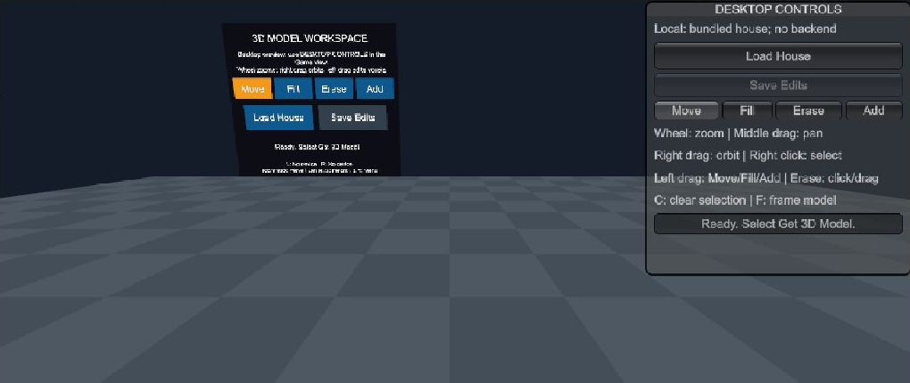
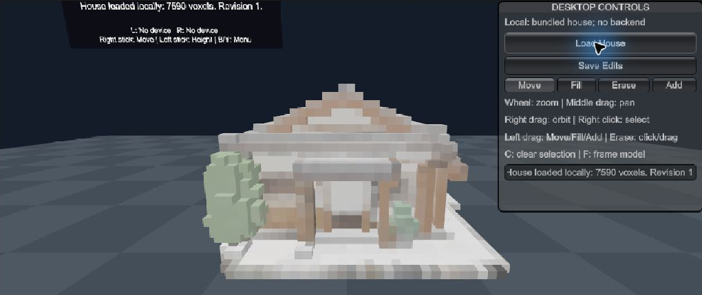
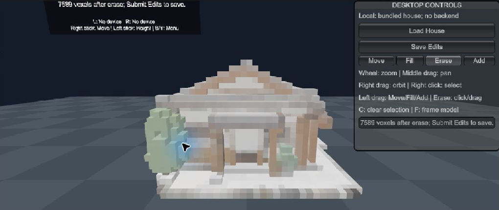
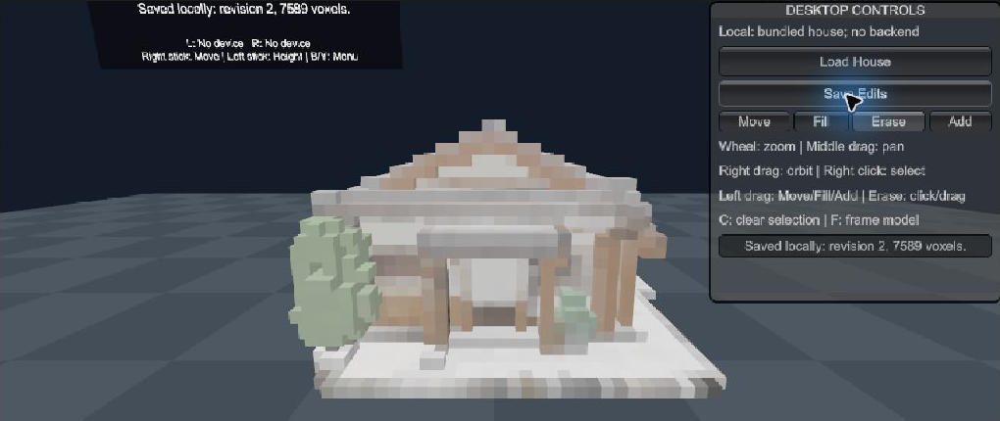

# Quest 3S + Quest Link: Windows PC VR voxel editing

This guide describes the **offline house editing** scene in `Assets/Scenes/SampleScene.unity`. In PC VR, the Unity Editor and voxel data run on the Windows laptop. Quest Link sends headset and controller tracking to Unity and streams the stereo render back to Quest 3S. This differs from running the Android APK on the headset or viewing a flat desktop cast. The scene does **not** call TRELLIS.2, the remote RTX 3090, SSH, or the Python generation backend.

## What we implemented

1. `Assets/XR/XRGeneralSettingsPerBuildTarget.asset` is configured to start the Windows OpenXR loader automatically. `Assets/XR/Settings/OpenXRPackageSettings.asset` enables Oculus Touch and Quest Touch Plus controller profiles for Windows.
2. `Assets/Editor/QuestPro/Quest3SPCVRSetup.cs` provides **VR-Crafter > PC VR** menu actions to enable the profiles, switch the Editor to Windows, and validate the offline scene and bundled voxel cache.
3. `Assets/Scripts/QuestPro/Quest3SPCVRRuntimeStatus.cs` reports a **LIVE PASS** only when the Windows process has an active XR display, a tracked head, and at least one tracked controller. Configuration checks alone do not count as a live Quest Link test.
4. `SampleScene` loads `Assets/Resources/PropertyDemoVoxels.json`, an editable voxel cache baked from `backend/models/PropertyDemoModel.glb` (the house). It shows only the voxel house. Cube batching renders the voxels and surface colliders support selection and editing.
5. **Save Edits** writes `PropertyDemoVoxels.edits.json` to Unity's `Application.persistentDataPath` on the **PC**. Loading the house again restores that PC-side revision. The Android APK has a separate save location on Quest.

```text
Quest 3S headset + Touch controllers
       | tracking and button input ↑   stereo video ↓
       +---------- USB Quest Link ----------+
                                           Windows laptop
                                      Unity Editor + OpenXR
                                      bundled house voxels
                                      local edit/save file
```

## Start a PC VR session

1. Use Unity **6000.3.15f1** on Windows. Open this repository's Unity project and `Assets/Scenes/SampleScene.unity`.
2. In Unity, stop Play Mode. Run **VR-Crafter > PC VR > Enable Quest 3S Link profiles**, then **Switch editor to Windows**. Confirm the title bar says **Windows, Mac, Linux**. Run **Validate offline PC VR configuration**; the Console should contain `Configuration PASS`.
3. Connect Quest 3S with a data-capable USB cable. Open **Meta Horizon Link** on the laptop. In the headset, enable **Quest Link** and explicitly select **Launch Quest Link**. The headset must enter the Link PC VR environment; simply being connected by USB or seeing the standalone Quest home is insufficient.
4. In Unity, press **Play**. Look for `[Quest 3S PC VR] LIVE PASS` in the Console and `L: Ready` or `R: Ready` on the floating panel. If the Console says `LIVE NOT VERIFIED` or Unity creates a **Desktop Preview Camera**, the Editor is running in desktop preview, even if the headset is connected.
5. Point a Touch controller at **Load House**, press its index **Trigger**, and wait for `Revision 0: 7590 voxels ready` (or a later saved revision). The house appears in front of you. No image upload or remote generation occurs.

The PC's Meta OpenXR runtime can be checked with `reg query "HKLM\SOFTWARE\Khronos\OpenXR\1" /v ActiveRuntime`. It should point to Meta Horizon's `oculus_openxr_64.json`. Quest Link requires a supported PC graphics path; a working USB cable alone does not prove that the PC VR compositor is available.

## Operations inside Quest 3S

These are **Touch controller** actions implemented by the scene. Bare-hand pinch editing is not implemented.

| Action | How to perform it | Visible result |
|---|---|---|
| Load the model | Point at **Load House**, press index Trigger | Voxel house appears; status reports voxel count |
| Select voxels | Hold **Grip** and sweep the ray over voxels | Selected voxels turn magenta |
| Clear selection | Press **A** on right or **X** on left | Magenta selection clears |
| Move | Select **Move**; point at a voxel and hold Trigger while moving the controller | One voxel or the selected group moves on the voxel grid |
| Fill | Select **Fill**; drag with Trigger | The group moves and leaves copies in vacated cells |
| Erase | Select **Erase**; drag a voxel/group through other occupied cells | Voxels crossed by the drag path are removed. The desktop preview also supports click/drag surface erasing. |
| Add | Select **Add**; hold Trigger and sweep the placement preview | New voxels are placed along the path |
| Save and reload | Press **Save Edits**, then **Load House** | Status reports a local revision; the saved edited house is restored |
| Reposition view | Use the right stick to move, left stick to change height, **B/Y** to bring the menu in front | Workspace can be approached and panel recentered |

On this scene, **Erase** with a VR controller currently uses a drag through occupied cells. A direct controller ray click that deletes a single voxel is **not** implemented; direct click/drag Erase is available in the desktop preview.

## Key frames and verification evidence

### 2026-10-31 Link session update / Quest Link 连接进度

The Quest 3S user opened **Quest Link > Open Dash** and reported seeing the gridded Link environment. At 22:03 local time, the Meta PC service log recorded Dash visibility and tracking activity. This is evidence that the headset reached the Link environment; it is **not yet** evidence that VR-Crafter ran inside the headset. In the last simultaneous Unity test, OpenXR returned `XR_ERROR_FORM_FACTOR_UNAVAILABLE` and the probe reported `XR active=False`. The Unity Editor process then exited before a successful retest. The PC app also showed a hardware-compatibility warning. A live Unity `LIVE PASS`, controller edit, and headset mirror frames remain pending.

头显已进入 **Quest Link > Open Dash**，用户看到了网格空间；电脑端 Meta 日志也记录了 Dash 与追踪活动。**目前不能据此宣称 Unity 项目已经在头显内运行。** Unity 上一次检测仍是 `XR active=False`，之后编辑器退出。下一步是在头显持续留在 Link 空间时重新打开 Unity、按 Play，并在 Console 确认 `LIVE PASS`；随后用控制器加载房屋、移动一个 voxel、保存编辑，再截取真正的头显镜像关键帧。

The images below are **Unity desktop preview** frames of the same offline scene and controls. They document the editing workflow but are **not** headset captures or proof that Quest Link is rendering in VR. Replace or augment them with Quest Link mirror frames only after the Console reports `LIVE PASS` and a controller edit is observed through the headset.









### Verification log

| Check | Result on 2026-10-31 |
|---|---|
| Unity Windows OpenXR / Touch / Touch Plus configuration | **PASS** in Unity Console |
| Quest 3S USB cable | Meta Horizon Link reported compatible USB 3, **1.7 Gbps** |
| Offline house loading in Unity desktop preview | **PASS**: 7,590 voxels, 6,468 exposed colliders after Cube batching |
| Local Save Edits in Unity desktop preview | **PASS**: revision file written under Windows `AppData/LocalLow` |
| Live Quest Link XR display + tracked controller | **Not yet verified**: Windows Unity reported `XR_ERROR_FORM_FACTOR_UNAVAILABLE` and `LIVE NOT VERIFIED`; Meta Link showed a hardware-incompatible banner on this RTX A2000 laptop |
| Controller Move/Fill/Erase/Add through Quest Link | **Not yet verified**; do not describe the desktop frames above as headset evidence |

For a live PC VR recording, open Meta's **OculusMirror.exe** while Quest Link is active and Unity reports `LIVE PASS`; record frames before Load House, after loading, during a controller move, and after Save Edits. Keep the Unity Console log with the same session. If Link cannot start on this computer, use a Link-compatible Windows PC and repeat the live checks. The native Quest APK is a separate path and cannot demonstrate PC GPU offload.

## Troubleshooting

- **`XR_ERROR_FORM_FACTOR_UNAVAILABLE` / `LIVE NOT VERIFIED`:** the PC OpenXR runtime cannot see an active Link headset. Launch Quest Link *inside the headset*, then stop and restart Unity Play. Check the Meta Horizon Link hardware warning and its device status. Do not infer success from USB or ADB connectivity.
- **Panel says `No device` or `No pose`:** wake and pair a Touch controller, bring Unity/Link into focus, then restart Play. The runtime probe requires head and controller tracking.
- **House loads but editing is slow:** check that the scene uses `voxelShape: 3` (Cube). This activates `QuestVoxelBatchRenderer`; the Sphere setting creates thousands of individual renderers and does not expose the BoxColliders expected by the editor.
- **Saved edit missing on Quest:** PC VR saves to the Windows user's Unity persistent-data folder; the native Android app saves to a different device. Transfer or explicitly sync the save file if cross-device continuity is needed.

Meta references: [Use Link for App Development](https://developers.meta.com/vr/documentation/unity/unity-link/), [Deploy and Test](https://developers.meta.com/vr/documentation/unity/unity-deploy-and-test/), [Hand Tracking Overview](https://developers.meta.com/vr/documentation/unity/unity-handtracking-overview/).
