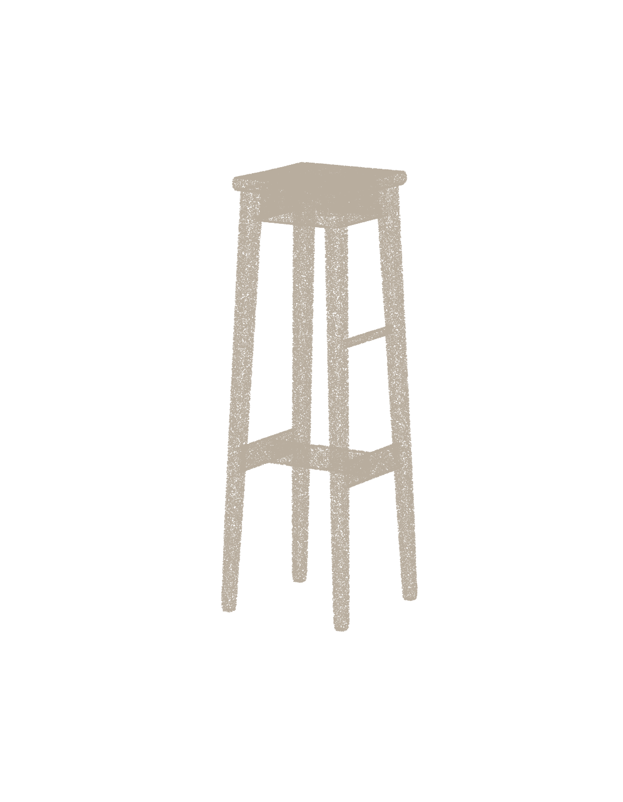
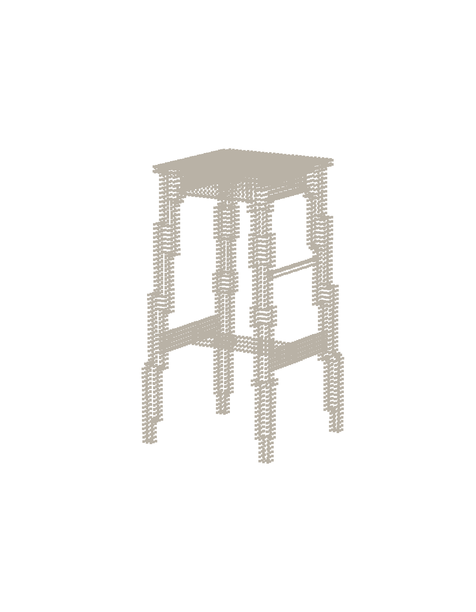
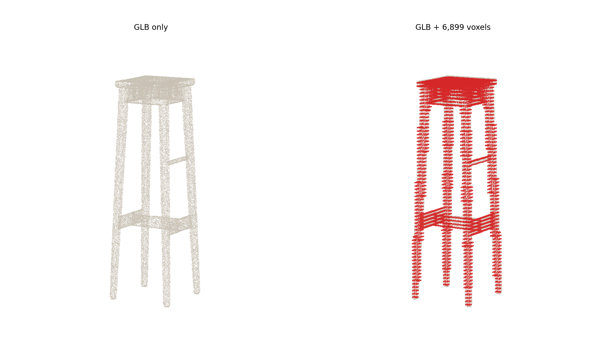

# Verification: TRELLIS.2 → Unity

This folder records the first real GPU and Unity run of the `trellis2` path
(2026-10-26). It is evidence for the numbers in
[`README-Implementation.md`](../README-Implementation.md) and the setup in
[`backend/RUNBOOK-L40S.md`](../backend/RUNBOOK-L40S.md).

## Environment

| Item | Value |
|---|---|
| GPU | 1× NVIDIA L40S, 44 GiB, 128 CPU cores |
| CUDA | 13.2 |
| Python | 3.12, PyTorch 2.12, transformers 5.9 |
| CUDA extensions | nvdiffrast 0.4.0, CuMesh, FlexGEMM, o-voxel (all `sm_89`) |
| Backend | FastAPI + TRELLIS.2-4B (six 1024 checkpoints) + BiRefNet + DINOv3 ViT-L |
| Unity | 6000.6.3f1 editor, Windows Standalone target |

The model weights were made local: TRELLIS from `hf-mirror.com`, DINOv3 ViT-L
from ModelScope (the Hugging Face repository is gated), and BiRefNet from the
Hugging Face mirror.

## Generation result

Input: a wooden chair photo (1024×1535). One `POST /generate` with
`response_mode=both`:

| Metric | Result |
|---|---|
| Voxels | 6,899 (64³ grid) |
| Load | 79.3 s |
| Stage 1 (structure) | 3.2 s |
| Stage 2 (shape + texture + GLB) | 86.3 s |
| GLB | 22.2 MB, 482,879 triangles |
| Peak VRAM | 14.5 GB |

`POST /generations/{id}/revisions` with the same voxels plus one red voxel
returned revision 1: 6,900 voxels, new id 6899, and a new 23.0 MB GLB.

The full `POST /generate` response is in
[`generate-response.json`](generate-response.json).

## Visual checks

Textured GLB rendered from the generated file:



The 6,899 voxels returned by the backend:



The GLB and the voxels in the same Unity coordinates (GLB scaled by
`64 × 0.015`, lifted by `(64 − 1) / 2 × 0.015`). Voxel centres are red:



Measured distance from each voxel centre to the nearest GLB surface:

| Statistic | Distance |
|---|---|
| Median | 2.62 mm |
| Mean | 3.02 mm |
| 95th percentile | 6.97 mm |
| Maximum | 10.33 mm |
| Within 7.5 mm (half a voxel) | 96.6% |

## Unity check

Unity 6000.6.3f1 loaded the GLB through `glTFast` and built the voxel batch.
The console showed:

```
[ModelGenerationServerTest] Response received: 942065 chars
[ModelGenerationServerTest] Loading GLB: https://.../model.glb
[ModelGenerationServerTest] GLB model loaded.
[ModelGenerationServerTest] Voxels generated: 13676
```

The Unity run produced 13,676 voxels instead of 6,899 because Unity re-encodes
the input texture before upload; the shape is the same chair.

## Not covered

- The six batch validation commands in
  [`README-Implementation.md` §5.7](../README-Implementation.md#57-验证脚本在-windows-上运行)
  were not run.
- The headset was not connected: GLB/voxel alignment, facing direction, frame
  rate and controller interaction are still unverified.
- Only one image and one seed were tested.
